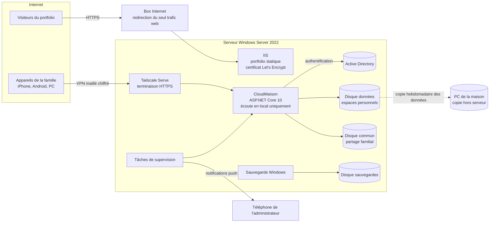

# Homelab : serveur maison et CloudMaison

Serveur personnel sous **Windows Server 2022**, monté et administré par moi à la maison. Il héberge mon portfolio public et **CloudMaison**, un cloud familial privé que j'ai développé en **ASP.NET Core**, connecté à un annuaire **Active Directory**.

Ce dépôt documente ce qui est réellement en service : l'architecture, les choix techniques, l'automatisation, les sauvegardes et la méthode de déploiement.

📄 **Version PDF complète** : [Documentation-Homelab-CloudMaison.pdf](Documentation-Homelab-CloudMaison.pdf)

> Par sécurité, ce dépôt ne contient **aucune** adresse IP ou MAC, aucun nom d'hôte, aucun port, aucun identifiant, mot de passe ou e-mail, ni aucune configuration détaillée permettant de cibler l'infrastructure. Les captures d'écran utilisent des données fictives.

## En bref

| | |
|---|---|
| **Matériel** | Ancienne tour HP réemployée : SSD système + 3 disques durs de 1 To (données personnelles, dossier commun, sauvegardes) |
| **Système** | Windows Server 2022, contrôleur de domaine Active Directory, IIS, Sauvegarde Windows Server |
| **Applications** | Portfolio statique (IIS, HTTPS Let's Encrypt) et CloudMaison (ASP.NET Core 10, Razor Pages) |
| **Accès distant** | CloudMaison n'est **jamais exposé sur Internet** : accès uniquement via un VPN maillé (Tailscale), en HTTPS |
| **Utilisateurs** | 4 membres de la famille, chacun avec son compte et son espace privé |
| **Exploitation** | Démarrage automatique, surveillance avec redémarrage, alertes push sur téléphone, sauvegarde quotidienne et copie hebdomadaire hors serveur |

## Architecture

Plus de détails : [docs/architecture.md](docs/architecture.md)

## CloudMaison

Un « Google Drive » familial auto-hébergé, développé de zéro :

- **Espaces personnels** isolés : envoi de plusieurs fichiers à la fois, recherche, renommage, aperçu des PDF et images, corbeille avec restauration.
- **Galerie photos** privée, avec vérification de la signature réelle des images envoyées.
- **Dossier commun** familial : sous-dossiers, déplacement de fichiers, recherche dans tout le partage.
- **Administration**, réservée à deux comptes : état de l'application, des sauvegardes et des disques, alertes, statistiques de stockage par membre.
- **Interface V2** « NAS sombre », pensée pour le téléphone (menu latéral repliable, grandes zones tactiles).

| Mes fichiers (mobile) | Administration |
|---|---|
|  |  |

Fonctionnement et sécurité de l'application : [docs/cloudmaison.md](docs/cloudmaison.md)

## Exploitation

- **Disponibilité** : démarrage automatique sous un compte de service sans privilèges, contrôle de santé toutes les 2 minutes et redémarrage automatique avec protection contre les boucles. → [docs/supervision.md](docs/supervision.md)
- **Alertes** : collecte d'état sous un compte système, affichage dans l'administration et notification push en cas de nouveau problème ou de retour à la normale (application, disques pleins, sauvegardes, température et santé SMART des disques). → [docs/supervision.md](docs/supervision.md)
- **Sauvegardes** : sauvegarde quotidienne complète sur un disque dédié, copie hebdomadaire des données irremplaçables vers une autre machine avec 4 semaines d'historique, restauration testée. → [docs/sauvegardes.md](docs/sauvegardes.md)
- **Déploiements** : compilation hors production, vérification des sources par empreinte, sauvegarde, contrôles avant et après, **retour arrière automatique**. → [docs/deploiement.md](docs/deploiement.md)

## Ce que j'en retiens

Les problèmes réels rencontrés et leur résolution (proxy inverse et cookies sécurisés, liaisons IIS, tâches planifiées qui se rattrapent au démarrage, etc.) sont détaillés dans [docs/retours-experience.md](docs/retours-experience.md).

## Technologies

Windows Server 2022 · Active Directory · GPO · NTFS · IIS · URL Rewrite · Let's Encrypt (win-acme) · ASP.NET Core 10 · Razor Pages · C# · PowerShell · Planificateur de tâches · Sauvegarde Windows Server · Tailscale · ntfy · HTML/CSS/JS

---

Projet personnel de **Célian Crochat**, étudiant en BUT Réseaux & Télécommunications. Portfolio : [crochatcelian.fr](https://crochatcelian.fr)
